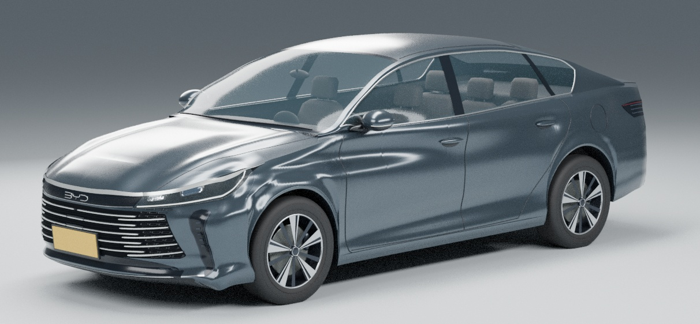

# BYD Destroyer 05



Open [the Blender scene](Destroyer_05.blend) to inspect the model and the fitted cameras. Frame 1 is the studio view. Frames 2–7 select the side, front, rear, front three-quarter, left rear three-quarter and right rear three-quarter cameras. Frames 8 and 9 show the grille and headlamp close-ups. The front wheels turn for the three oblique reference poses. Toggle the **Door mirrors** collection in the Outliner to inspect the rear silhouette. The studio uses Blender area lights and a plain world background. The [portable GLB](Destroyer_05.glb) opens with the steering centred and has a separate pivot for each wheel.

## Outline checks

The [front outline overlay](checks/front_outline.jpg) shows the model from three fitted cameras. Cyan follows its projected mesh. Amber dots mark edge positions measured on the original photographs. The mean absolute difference is 1.1 pixels across 32 front fender measurements and 2.2 pixels across 12 points on the underside of the bumper in the three-quarter view. The reference width is 1,254 pixels.

Each lamp contains a faceted inboard reflector and an outboard projector under a swept cover. The lower light guide turns upward at the outer corner. Each of the five grille rows has a long central blade and two shorter outboard strips that sit lower and overlap its ends. The grille check compares 30 strip endpoints, with a mean difference of 1.9 pixels. The rear check measures 20 body edges with the mirrors hidden, with a mean difference of 2.2 pixels. The individual points and fitted cameras are recorded in the [measurements](checks/measurements.json).

The body envelope is **4,780 × 1,837 × 1,495 mm** and the wheelbase is **2,718 mm**. The model uses the listed 1,580 / 1,590 mm front / rear tracks and the 215/55 R17 tyre option. The mirror span is estimated from the photographs. [Configuration sheet](https://yhe-motors.com/wp-content/uploads/2023/11/BYD-Destroyer-05-Champion-Edition.pdf)

The exterior follows the original Destroyer 05 nose, light bars, four-door body and split-finish wheels in the gallery. Graphite paint makes the surface contours visible in the studio renders. Compound panel curvature, reflector optics and the cabin furniture visible through the glass are photo-based approximations. [Exterior gallery](https://importbyd.com/product/byd-destroyer-05-sedan-king-dmi-phev/)

## How the fit was checked

The checker reads the exported GLB in metres, applies its assembly transforms, and measures bumper-to-bumper length, body width, height from the tyre contact plane and hub spacing. It also measures the span across both mirrors.

For each whole-car photograph, the solver fits a perspective camera to the projected outer rectangle. Front and rear widths use the body edges. The straight rear fit uses the tyre contact points, plate edges and distant mirror tips as separate depth cues. The side and oblique fits also use wheel centres. The oblique fits use apparent rim diameters to help estimate focal distance, with the visible plate centre providing an additional control in each oblique view. Each camera has a single image scale. The materials, mesh proportions and wheelbase are shared across all six reference views.

The front outline check projects the exported front shell, wheel arch lips and fascia triangles at twice the reference resolution. It samples both fenders below the mirror housings and traces the lower chrome lip separately. In the oblique view, it follows the exposed underside on either side of the far tyre. Measurements use the original photo pixels.

The two close-up cameras use visible trim and plate or blade landmarks for registration. The grille measurements compare both ends of each short strip and the outer tips of the five main rows on both sides. The lamp measurements include both optical centres and the inner end of the running light.

Door handles, pillar position, arch lips and lamp tips provide feature checks after camera fitting. The rear body check measures left and right outline positions at ten image rows below the mirror housings. The side view also samples the upper outline at 20 image columns. Pixel errors are measured on the full **1,254 × 836** reference images before the presentation crops. In the measurements file, each camera array records yaw, pitch and roll in degrees, camera distance in millimetres, scale in pixels per millimetre, and horizontal and vertical image offsets in pixels. The manually selected points and estimated camera poses limit the precision. [Coordinates, landmark errors and measured dimensions](checks/measurements.json)

## Edit or regenerate

[model.py](model.py) contains the body sections, wheel openings, glazing boundaries, bumpers, trim and wheel meshes. Its coordinates are millimetres, with the origin on the ground under the front axle and positive X toward the rear. Run it with Python, NumPy and SciPy to rebuild the GLB.

```sh
python3 model.py
```

To rebuild the self-contained Blender scene, studio preview, outline overlay and measurements, run the checker with Blender, SciPy, NumPy, Pillow and OpenCV installed. The scene was built with Blender 5.0.

```sh
python3 check_views.py
```

For local photo comparisons, place the eight gallery photographs in a directory outside the repository, using their original filenames. The command below writes the comparison sheets to the Git-ignored `.local/BYDDestroyer05/` folder at the repository root. The scene uses the same fitted cameras in both workflows.

[Side photograph](https://importbyd.com/wp-content/uploads/2025/11/e01f10c7e91c977905c8f66dc79815c52508x0.webp) · [Front photograph](https://importbyd.com/wp-content/uploads/2025/11/bc29db0365504994c4b978c5825e43e82508x0.jpg) · [Rear photograph](https://importbyd.com/wp-content/uploads/2025/11/d2e6aa1ee547b6d4b9a927a90bde36512508x0.jpg) · [Front three-quarter photograph](https://importbyd.com/wp-content/uploads/2025/11/e13c6b8cdec3110a288bde30ab0726262508x0.jpg) · [Left rear three-quarter photograph](https://importbyd.com/wp-content/uploads/2025/11/fea7b89b4cde73da63f3ff7d76e0fefc2508x0.jpg) · [Right rear three-quarter photograph](https://importbyd.com/wp-content/uploads/2025/11/3b64e65a56a09816ea69a1a665dc8b812508x0.jpg) · [Grille photograph](https://importbyd.com/wp-content/uploads/2025/11/658147ab1c148e3776f259d89ca7ecbf2508x0.jpg) · [Headlamp photograph](https://importbyd.com/wp-content/uploads/2025/11/3d2842e7bbbc9ba1bf9276619561ed9b2508x0.webp)

```sh
python3 check_views.py /path/to/reference/photos --samples 256
```

The model and original geometry follow the [collection licence](../LICENSE). The linked reference photographs retain their owners’ rights.
